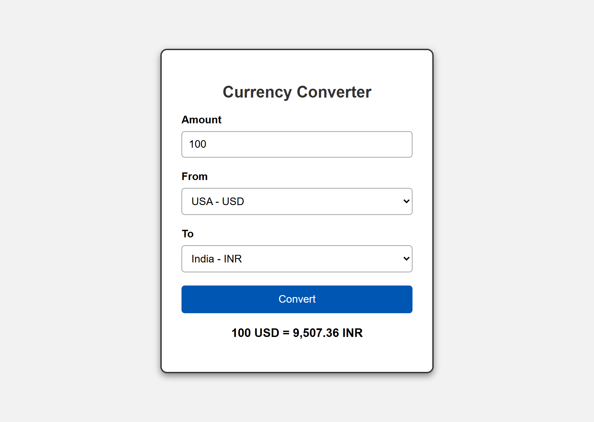
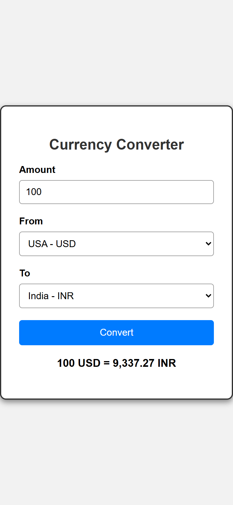

# 💱 Currency Converter

A live currency converter in plain HTML, CSS and JavaScript. Enter an amount, pick two currencies, and it converts with today's real exchange rates from a free public API.

### 🌐 [Open it live](https://vineetsing9019.github.io/JavaScriptProject/)


<table>
  <tr>
    <td width="62%"></td>
    <td width="38%"></td>
  </tr>
  <tr>
    <td align="center">Laptop</td>
    <td align="center">Phone</td>
  </tr>
</table>

## Features

- Converts between 8 currencies: USD, INR, EUR, GBP, JPY, AED, CAD and AUD
- Live exchange rates from the free [ExchangeRate API](https://www.exchangerate-api.com/docs/free) (`open.er-api.com`), no API key needed
- Checks the amount before converting (it must be a number above 0)
- Shows "Converting..." while it loads, and a clear message if the internet or the API fails
- Results with thousands separators and two decimals, e.g. `100 USD = 9,337.27 INR`

## How it works

```
Click Convert
   │
   ├─ amount not a number, or ≤ 0?  →  "Please enter a valid amount."
   │
   ├─ fetch https://open.er-api.com/v6/latest/{FROM}      (async / await)
   │      └─ network error or bad response?  →  "Unable to convert. Please check your internet…"
   │
   └─ rate = data.rates[TO]
      result = amount × rate  →  "100 USD = 9,337.27 INR"
```

The heart of it:

```js
let response = await fetch(`https://open.er-api.com/v6/latest/${from}`);
if (!response.ok) throw new Error("Unable to get exchange rates.");

let data = await response.json();
if (data.result !== "success" || !data.rates[to]) throw new Error("Currency conversion is unavailable.");

let convertedAmount = amount * data.rates[to];
result.innerText = `${amount} ${from} = ${convertedAmount.toLocaleString("en-US", {
  minimumFractionDigits: 2, maximumFractionDigits: 2 })} ${to}`;
```

## What I used

| Concept | Where |
|---|---|
| Fetch API with `async` / `await` | getting the rates for the chosen currency |
| `try` / `catch`, `response.ok` and the API's `result` field | error handling |
| `Number.isFinite` | rejecting empty or non-number amounts |
| DOM methods (`getElementById`, `innerText`) | reading the form and showing the result |
| Template literals and `toLocaleString` | building and formatting the result |
| CSS Flexbox | centring the card on the page |

## Run it locally

No install needed:

```bash
git clone https://github.com/Vineetsing9019/JavaScriptProject.git
cd JavaScriptProject
# open index.html in a browser (it needs internet for the live rates)
```

## What I learned

- Calling a real REST API from the browser with `fetch` and `async` / `await`
- Never trusting the response: checking `response.ok` and the data before using it
- Giving the user a clear message for every state: loading, wrong input, no internet
- Formatting money properly with `toLocaleString`

## Next steps

- A ⇄ button to swap the two currencies
- Remember the last pair in `localStorage`
- More currencies, filled in from the API's own list

## Author

**Vineetsing Girase**: Java Full Stack Developer, Badlapur, India
[GitHub](https://github.com/Vineetsing9019) · [Portfolio](https://vineetsing9019.github.io/portfolio/)
